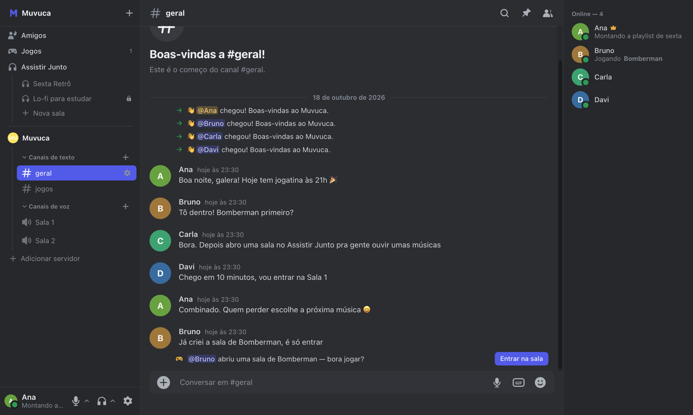
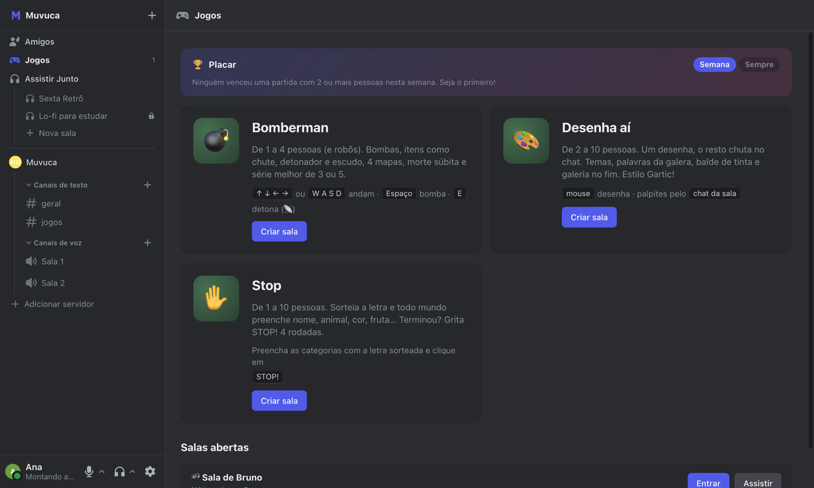
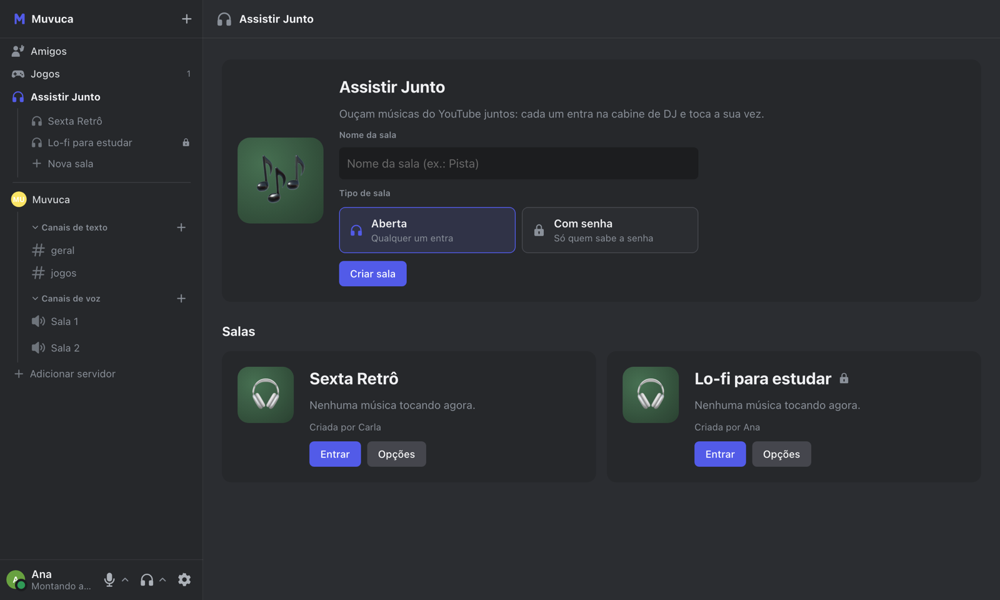
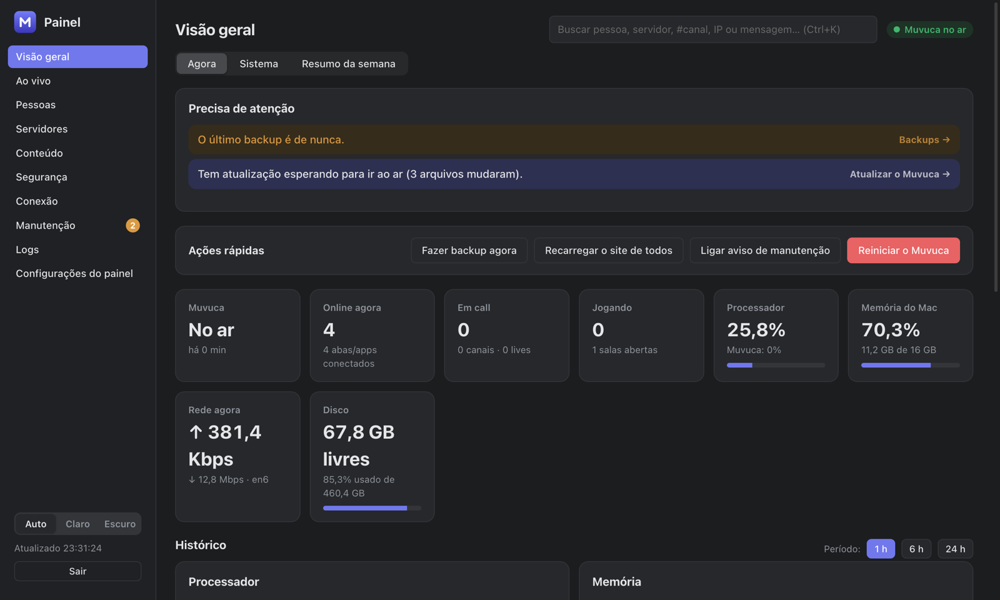

# Muvuca

Um lugar para o seu grupo de amigos conversar, entrar em call, jogar e ouvir música junto, do jeito do Discord, mas **rodando num computador seu**. As conversas, as fotos e as contas ficam guardadas na sua máquina, sem anúncios e sem depender de nenhuma empresa.

Tudo em português do Brasil.



- [O que tem no Muvuca](#o-que-tem-no-muvuca)
- [Como funciona por dentro](#como-funciona-por-dentro)
- [O que você precisa](#o-que-você-precisa)
- [Instalação passo a passo](#instalação-passo-a-passo)
- [Deixar rodando sozinho](#deixar-rodando-sozinho)
- [Painel de administração](#painel-de-administração)
- [Atualizar](#atualizar)
- [Backup e restauração](#backup-e-restauração)
- [App do computador (Mac e Windows)](#app-do-computador-mac-e-windows)
- [Solução de problemas](#solução-de-problemas)
- [Para quem vai mexer no código](#para-quem-vai-mexer-no-código)
- [Licença](#licença)

---

## O que tem no Muvuca

**Chat**
- Servidores com canais de texto e de voz, organizados em categorias, como no Discord.
- Mensagens com resposta, edição, reações, emojis personalizados, GIFs, prévia de links, anexos (fotos, vídeos e arquivos) e mensagens de voz.
- Menções a pessoas, a cargos e a todo mundo (`@todos`).
- Conversas privadas e em grupo, lista de amigos e pedidos de amizade.
- Busca no histórico, mensagens fixadas e enquetes.

**Voz e vídeo**
- Calls com câmera e transmissão de tela (live), inclusive com o som do programa transmitido no app do Mac e do Windows.
- Redução de ruído, aviso de microfone mudo, volume separado por pessoa e indicador de qualidade da conexão.
- Chat ao lado da call e janela flutuante para continuar vendo a live em outra tela.
- Se a página recarregar ou a internet piscar, a call volta sozinha.
- Ligação direto na conversa privada, que toca para a outra pessoa.

**Jogos**
- Stop, Desenha aí e Bomberman, jogados direto no navegador, com placar da semana.



**Assistir Junto**
- Salas para ouvir músicas do YouTube juntos, como no antigo plug.dj: cada pessoa entra na cabine de DJ e toca a sua vez, e todo mundo ouve sincronizado.
- Qualquer pessoa cria uma sala, aberta ou com senha.



**Organização e segurança**
- Cargos com permissões (gerenciar canais, expulsar, mover pessoas na call, fixar mensagens e outras), cor no nome e apelido por servidor.
- Canais privados (só alguns cargos enxergam), modo lento e proteção contra spam.
- Convites com validade e limite de usos; o cadastro exige um código de acesso ou um convite.
- Lista de aparelhos conectados, com "sair deste aparelho".
- Temas claro, escuro e 22 coloridos; aba de Novidades com o que mudou em cada versão.
- Notificações no celular: o site pode ser instalado na Tela de Início do iPhone e do Android.

**Para quem administra**
- Um painel à parte, com quem está online, calls e lives, uso do computador e da internet, histórico de quedas, auditoria, erros do site, gerenciamento de contas e servidores, backup e atualização com um clique. Veja [Painel de administração](#painel-de-administração).

---

## Como funciona por dentro

```
                         Internet
                            │
            ┌───────────────┼──────────────────────────────┐
            │  roteador (redireciona as portas para o computador)
            └───────────────┼──────────────────────────────┘
                            │
  ┌─────────────────────────┼─────────────────────────────────────────┐
  │ Computador do servidor  │                                         │
  │                         ▼                                         │
  │   Caddy (HTTPS automático, portas 443 e 8443)                     │
  │     ├── seu-dominio ............► Muvuca (Node, porta 3000)       │
  │     │                               site, WebSocket, banco SQLite │
  │     ├── seu-dominio/rtc ........► LiveKit (sinalização, 7880)     │
  │     └── painel.seu-dominio .....► Painel (Node, porta 3002)       │
  │                                                                   │
  │   LiveKit: áudio e vídeo das calls (7881 TCP, 50000–50200 UDP)    │
  │            e TURN para redes restritas (5349 TCP, 3478 UDP)       │
  │   DuckDNS: mantém o domínio apontando para o IP de casa           │
  │   Backup: todo dia às 4h, em ~/Backups/Muvuca                     │
  └───────────────────────────────────────────────────────────────────┘
```

- **O Muvuca em si** (`server.js`, `src/`, `db.js`) é um servidor Node.js. Ele entrega o site (`public/`), mantém uma conexão WebSocket com cada aba aberta e guarda tudo num banco **SQLite** (`data/muvuca.db`), usando o SQLite que já vem no Node, sem instalar nada à parte. Fotos, emojis e anexos ficam em `data/`.
- **A voz e o vídeo** passam pelo [LiveKit](https://livekit.io), um servidor de mídia que roda no mesmo computador. O site pede ao Muvuca um "passe" para entrar numa sala de voz e se conecta direto ao LiveKit.
- **O [Caddy](https://caddyserver.com)** fica na frente de tudo: tira e renova sozinho o certificado HTTPS (Let's Encrypt) e repassa cada endereço para o programa certo.
- **O painel** (`painel/`) é um processo separado, com login próprio. Por isso continua no ar, e mostra o que aconteceu, quando o Muvuca cai.
- **O `start.sh`** sobe o LiveKit, o Caddy, o atualizador do DuckDNS e o Muvuca juntos, e encerra tudo se uma das partes cair, para o sistema subir de novo. **O `server.sh`** transforma isso num serviço do macOS, que liga sozinho e se reinicia.
- **O site** é JavaScript puro, sem etapa de build: os arquivos de `public/` são entregues como estão.

### Estrutura do repositório

| Caminho | O que é |
|---|---|
| `server.js`, `src/`, `db.js` | Servidor do Muvuca (Node.js, WebSocket, SQLite) |
| `public/` | O site (HTML, CSS e JavaScript) |
| `painel/` | Painel de administração |
| `desktop/` | App do Mac e do Windows (Electron) |
| `start.sh` | Sobe tudo junto (LiveKit, Caddy, DuckDNS e o Muvuca) |
| `server.sh` | Instala e controla o Muvuca como serviço do macOS |
| `painel.sh` | Instala e controla o painel, e define a senha dele |
| `backup.sh` | Backup do banco e dos arquivos |
| `ddns-update.sh` | Atualiza o DuckDNS com o IP de casa |
| `Caddyfile`, `livekit.yaml` | Configuração do HTTPS e da voz |
| `channels.json` | Nome e canais do primeiro servidor, criado na primeira vez |
| `.env.example` | Modelo das configurações (copie para `.env`) |
| `test/`, `e2e/` | Testes automáticos |

---

## O que você precisa

**Computador**
- Um **Mac** ligado o tempo todo: qualquer Mac com Apple Silicon ou Intel recente serve, com **macOS 13 ou mais novo**. Os scripts de serviço usam recursos do macOS (launchd e caffeinate).
- O Muvuca é leve: o conjunto todo usa uns **250 MB de RAM**. O que pesa é a internet, principalmente o **upload**, quando tem live.
- De preferência ligado **no cabo**, na tomada.

**Programas** (pelo [Homebrew](https://brew.sh))
- **Node.js 22.13 ou mais novo**
- **Caddy**
- **LiveKit Server**
- **Git**

**Internet e rede**
- **IP público de verdade.** Se a operadora usa CGNAT (comum em fibra e 4G), ninguém de fora consegue chegar no seu computador; nesse caso, peça à operadora um IP público. Para conferir: o IP que aparece na página do roteador, na parte de internet ou WAN, tem que ser o mesmo que aparece em sites como `ifconfig.me`.
- Acesso à configuração do roteador, para **redirecionar portas**.
- **Um domínio.** O [DuckDNS](https://www.duckdns.org) dá um de graça (`seu-nome.duckdns.org`) e o Muvuca já sabe mantê-lo atualizado. Também dá para usar um domínio próprio.

**Opcional**
- Chave da **YouTube Data API v3** (Google Cloud), para buscar músicas pelo nome no Assistir Junto. Sem ela, cola-se o link do vídeo.
- Chave da **API do Giphy**, para os GIFs do chat.

---

## Instalação passo a passo

### 1. Instale os programas

```bash
brew install node caddy livekit git
```

Confira a versão do Node (precisa ser 22.13 ou mais nova):

```bash
node -v
```

### 2. Baixe o Muvuca

```bash
git clone https://github.com/marcosznl/muvuca.git
cd muvuca
npm ci
```

### 3. Crie o domínio (DuckDNS)

1. Entre em [duckdns.org](https://www.duckdns.org) com uma conta do Google, GitHub ou outra.
2. Crie um subdomínio, por exemplo `minha-turma`. O endereço vai ser `minha-turma.duckdns.org`.
3. Copie o **token** que aparece no topo da página.

O painel fica em `painel.minha-turma.duckdns.org`, e isso já funciona sem fazer nada a mais: o DuckDNS aponta os subdomínios junto.

**Com domínio próprio:** crie dois registros no DNS apontando para o seu IP público, `seu-dominio.com` e `painel.seu-dominio.com`. Você mesmo precisa mantê-los atualizados se o IP mudar.

### 4. Configure o `.env`

```bash
cp .env.example .env
```

Abra o `.env` num editor de texto e preencha. Cada item tem uma explicação no próprio arquivo. O essencial:

| Variável | Para quê |
|---|---|
| `LIVEKIT_API_KEY` e `LIVEKIT_API_SECRET` | Senha interna entre o Muvuca e o servidor de voz. Invente os dois; o segredo precisa de 32 caracteres ou mais (`openssl rand -hex 32` gera um). |
| `ACCESS_PASSWORD` | Código de acesso que os amigos digitam para criar conta. Passe só para quem você quer. |
| `OWNER_USERNAME` | Seu nome de usuário: essa conta vira dona do servidor principal. |
| `DUCKDNS_SUBDOMAIN` e `DUCKDNS_TOKEN` | O subdomínio (sem `.duckdns.org`) e o token do passo 3. |
| `DOMAIN` | Só se for usar domínio próprio em vez do DuckDNS. |
| `PUBLIC_PORT` | Porta extra para o site no IPv4, normalmente `8443`. Veja a explicação em [Portas](#5-abra-as-portas-no-roteador). |
| `YOUTUBE_API_KEY`, `GIPHY_API_KEY` | Opcionais. |

O `.env` tem senhas: ele fica fora do git e nunca deve ser publicado.

Se quiser, edite o `channels.json` para escolher o nome e os canais do primeiro servidor. Ele só é lido na primeira vez que o Muvuca liga.

### 5. Abra as portas no roteador

Primeiro, **fixe o IP do computador** na rede de casa (reserva de DHCP no roteador, ou IP manual no computador). Senão, um dia o IP muda e as portas passam a apontar para o lugar errado.

Depois, redirecione estas portas para esse IP:

| Porta | Protocolo | Para quê |
|---|---|---|
| **443** | TCP | Site pelo IPv6 e **renovação do certificado HTTPS**. Sem ela, o certificado vence em ~90 dias. |
| **8443** (ou o valor de `PUBLIC_PORT`) | TCP e UDP | Site e painel pelo IPv4 (o UDP deixa mais rápido). |
| **7881** | TCP | Voz, quando o UDP não passa |
| **50000–50200** | UDP | Voz e vídeo das calls (a principal) |
| **5349** | TCP | Voz para quem está em rede restrita (trabalho, faculdade, 4G) |
| **3478** | UDP | Voz para quem está em rede restrita |

**Por que 8443 e não só 443?** Muitas operadoras e roteadores não deixam usar a 443 de fora pelo IPv4. Então o site atende também numa porta extra, e o link fica `https://seu-dominio:8443`. Se a 443 funcionar na sua casa, pode deixar `PUBLIC_PORT` vazio e o link fica sem o `:8443`.

**Dois roteadores?** Se em casa tiver o modem da operadora e mais um roteador Wi-Fi atrás dele, as portas precisam passar pelos dois. O mais simples é ligar o computador direto no modem, ou colocar o roteador Wi-Fi em "modo Access Point" ou "modo ponte". Outra opção é colocar o segundo roteador na DMZ do modem.

### 6. Ligue pela primeira vez

```bash
./start.sh
```

Na primeira vez, o Caddy tira o certificado HTTPS, o que leva alguns segundos. Quando aparecer `Link para os amigos: https://...`, abra esse link, clique em criar conta e use o `ACCESS_PASSWORD`. Crie primeiro a conta com o nome que está em `OWNER_USERNAME`: ela vira dona do servidor.

Para desligar, use **Ctrl+C**.

Se algo não subir, as mensagens aparecem ali mesmo no Terminal. Veja também [Solução de problemas](#solução-de-problemas).

---

## Deixar rodando sozinho

Testou e funcionou? Feche o `./start.sh` (Ctrl+C) e instale o Muvuca como serviço do macOS. Assim ele liga sozinho quando você entra no Mac, se reinicia quando alguma parte cai e impede o Mac de dormir enquanto está na tomada:

```bash
./server.sh instalar
```

Outros comandos:

```bash
./server.sh status
```

| Comando | O que faz |
|---|---|
| `./server.sh status` | Mostra se está rodando |
| `./server.sh reiniciar` | Reinicia, por exemplo depois de mudar o `.env` |
| `./server.sh parar` / `ligar` | Desliga e liga |
| `./server.sh log` | Acompanha o log ao vivo (Ctrl+C sai) |
| `./server.sh backup` | Faz um backup agora |
| `./server.sh local` | Modo local: só neste computador, em `http://localhost:3000`, sem HTTPS (para testar fora de casa) |
| `./server.sh publico` | Volta ao normal |
| `./server.sh desinstalar` | Remove os serviços |

O serviço também instala o **backup diário às 4h** (veja [Backup](#backup-e-restauração)). Os registros ficam em `logs/` (o do Muvuca é `logs/server.log`).

No Mac, ative **Ajustes do Sistema → Bateria (ou Economia de Energia) → Iniciar automaticamente após falha de energia** e o login automático. Assim, se faltar luz, o Muvuca volta sozinho.

---

## Painel de administração



O painel fica em `https://painel.seu-dominio` (com `:8443` no fim, se você usa `PUBLIC_PORT`). Primeiro, crie o usuário e a senha dele:

```bash
./painel.sh senha
```

Depois, instale o painel como serviço:

```bash
./painel.sh instalar
```

O que dá para fazer no painel:
- **Visão geral:** quadro "Precisa de atenção", ações rápidas, uso de processador, memória, disco e internet, com histórico de 24 h.
- **Ao vivo:** quem está online, em que aparelho e versão do app, quem está em call e quem está transmitindo.
- **Pessoas:** cartão de cada conta, senha temporária, desconectar, bloquear e excluir conta.
- **Servidores e conteúdo:** renomear, passar a posse, excluir, ver e apagar mensagens e arquivos, planilhas.
- **Segurança:** tentativas de login, bloqueio de IP, auditoria de tudo o que foi feito.
- **Conexão:** limite de velocidade dos downloads de arquivos (para não engasgar a call).
- **Manutenção:** atualizar o Muvuca com um clique, voltar para uma versão anterior, backup e teste de restauração, aviso de manutenção, recarregar o site de todo mundo, reiniciar só a voz, desligar e ligar.
- **Logs:** registros do servidor, erros que aconteceram no navegador das pessoas e histórico de quedas.
- **Alertas no celular:** instale o painel na Tela de Início do celular e receba aviso quando o Muvuca cair ou o backup falhar.

---

## Atualizar

```bash
git pull
```

O site que está no ar é entregue a partir de `public/`. Para publicar com segurança, o painel usa uma cópia de trabalho em `public_next/` (fora do git). Depois do `git pull`, atualize essa cópia:

```bash
rsync -a --delete public/ public_next/
```

Depois, no painel: **Manutenção → Atualizar o Muvuca**. Ele roda os testes automáticos, faz backup e só então põe a versão nova no ar, reiniciando somente se o servidor mudou. Se o Muvuca não voltar em 60 segundos, ele volta sozinho para a versão anterior.

Sem o painel, também dá para reiniciar à mão:

```bash
./server.sh reiniciar
```

Se as dependências mudaram, rode também `npm ci`.

---

## Backup e restauração

O `backup.sh` roda sozinho todo dia às 4h e guarda em `~/Backups/Muvuca`:
- um arquivo `muvuca-AAAA-MM-DD_HHMM.tar.gz` com o banco (contas, servidores, mensagens), os emojis, as fotos e a chave das notificações do celular;
- a pasta `anexos/`, um espelho dos arquivos enviados no chat.

Fica sempre **só o backup mais recente**: o anterior só é apagado depois que o novo é conferido. O painel também faz um backup antes de cada atualização e testa a restauração toda semana.

O backup fica no mesmo computador. Para se proteger de defeito no disco ou de roubo, copie de vez em quando a pasta `~/Backups/Muvuca` para outro lugar (HD externo ou nuvem).

**Para restaurar:**

```bash
./server.sh parar
```

Com o Muvuca parado, guarde a pasta `data/` atual com outro nome e extraia o backup no lugar dela:

```bash
mv data data-antes
```

```bash
mkdir data && tar -xzf ~/Backups/Muvuca/muvuca-AAAA-MM-DD_HHMM.tar.gz -C data
```

```bash
rsync -a ~/Backups/Muvuca/anexos/ data/files/
```

Copie de volta os arquivos de configuração do painel que estavam em `data-antes/` (`painel-auth.json` e `painel-key`), ou crie a senha do painel de novo com `./painel.sh senha`. Depois, ligue:

```bash
./server.sh ligar
```

---

## App do computador (Mac e Windows)

O site funciona em qualquer navegador e pode ser instalado no celular. Para o computador, existe um app (pasta `desktop/`, feito com Electron) que acrescenta:
- notificações do sistema e contador de mensagens no ícone;
- **apertar para falar** global, que funciona com o app em segundo plano;
- som do programa transmitido na live (Mac 13+ e Windows 10+);
- abrir junto com o computador;
- atualização automática.

**Baixe pronto** na página de [Releases](https://github.com/marcosznl/muvuca/releases): `.dmg` para Mac (Apple Silicon ou Intel) e `.exe` para Windows. Ao abrir, use o menu **Muvuca → Endereço do servidor…** e digite o link do seu Muvuca, o mesmo que abre no navegador (por exemplo `https://seu-dominio:8443`). O app confere se existe um Muvuca nesse endereço antes de trocar, e se lembra dele nas próximas vezes. A mesma opção aparece na tela de "sem conexão".

Se você mesmo for gerar o app para os seus amigos, troque o endereço padrão em `DEFAULT_URL`, no começo de `desktop/main.js`: assim ninguém precisa digitar nada.

**Para gerar o app** (num Mac com as Ferramentas de Linha de Comando do Xcode: `xcode-select --install`):

```bash
cd desktop
npm ci
./publicar.sh
```

Os instaladores do Mac (`.dmg`, para Apple Silicon e Intel) e do Windows (`.exe`) vão para a pasta `downloads/`. O Muvuca entrega esses arquivos em `https://seu-dominio/baixar`, e os apps instalados se atualizam a partir dali. Para gerar o do Windows também, instale o compilador antes:

```bash
brew install mingw-w64
```

O app do Mac requer **macOS 12 ou mais novo** (o som do programa na live precisa do 13) e não é assinado pela Apple. Na primeira vez que abrir, o macOS avisa que não pode verificar o desenvolvedor. Para liberar: tente abrir uma vez, depois vá em **Ajustes do Sistema → Privacidade e Segurança** e clique em **Abrir Mesmo Assim** (macOS 15 ou mais novo). Em versões anteriores, clique com o botão direito no app e escolha **Abrir**. No Windows, se aparecer o aviso do SmartScreen, clique em **Mais informações → Executar assim mesmo**.

---

## Solução de problemas

**Ninguém de fora consegue abrir o site**
- Confira se o domínio aponta para o seu IP público: o IP de `ping seu-dominio` tem que ser o mesmo de `ifconfig.me`.
- Confira as portas com um verificador online de portas, a partir de outra rede (pelo 4G do celular, por exemplo). De dentro de casa, alguns roteadores não deixam acessar o próprio IP público.
- Se o computador mudou de IP na rede de casa (trocou do cabo para o Wi-Fi, por exemplo), as regras do roteador continuam apontando para o IP antigo. Fixe o IP (reserva de DHCP).
- Se tiver dois roteadores, veja [Abra as portas](#5-abra-as-portas-no-roteador).
- Se o IP na página do roteador for diferente do de `ifconfig.me`, é CGNAT: peça um IP público à operadora.

**O site abre, mas a call não conecta**
- Faltam as portas da voz: **50000–50200 UDP** e **7881 TCP**.
- Quem está numa rede de trabalho ou faculdade precisa da **5349 TCP** e da **3478 UDP**.
- Mudou a rede ou o IP público? Reinicie (`./server.sh reiniciar`): o LiveKit só descobre o IP público ao ligar.

**O Muvuca não sobe depois de um `brew upgrade`**
- Teste com `node -v`. Se aparecer um erro de biblioteca (`Library not loaded`), atualize o Node junto (`brew upgrade node`) e reinicie.
- Não deixe o Node travado com `brew pin`: o Homebrew atualiza as bibliotecas dele mesmo assim, e aí ele para de funcionar.

**O certificado HTTPS não sai ou venceu**
- A porta **443 TCP** precisa chegar ao computador: é por ela que o Let's Encrypt confirma que o domínio é seu.
- Os detalhes ficam em `logs/caddy.log`.

**Esqueci a senha do painel**
- Rode `./painel.sh senha` de novo.

**Alguém esqueceu a senha da conta**
- No painel: **Pessoas → a pessoa → Senha temporária**. Ela entra com a temporária e escolhe uma nova.

---

## Para quem vai mexer no código

```bash
npm test
```

Os testes sobem um Muvuca e um painel próprios, com banco e dados de teste: não precisam do `.env` e não mexem no Muvuca que está no ar.

Os testes de navegador (`npm run test:e2e`) usam o Playwright e rodam sozinhos no GitHub a cada envio, junto com os outros.

Para testar uma mudança sem afetar ninguém, suba uma segunda cópia em outra porta, com um banco de teste:

```bash
PORT=3001 DB_FILE=/tmp/teste.db PUBLIC_DIR=public_next node server.js
```

Regras do projeto:
- Tudo em português do Brasil: código comentado, textos da interface e mensagens de commit.
- Nunca versionar segredos nem dados: `.env`, `data/`, `logs/` e backups ficam fora do git.
- Mudou o comportamento: rode `npm test`, e funcionalidade nova ganha teste.
- Permissões novas entram em `public/js/permissions.js` (o servidor importa desse arquivo).
- Mudou algo que o pessoal vai notar: acrescente em `public/js/novidades-lista.js` (aba Novidades do site).

---

## Licença

[MIT](LICENSE).
